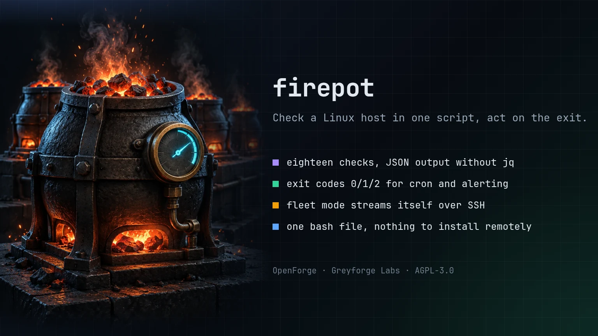
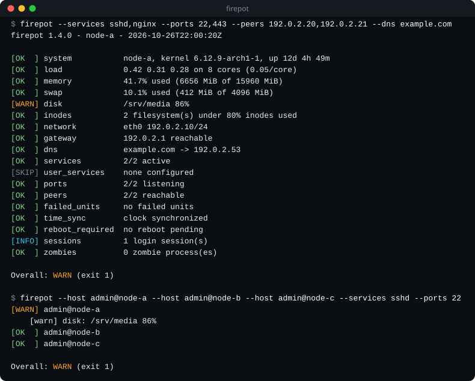

# firepot

> One bash script that checks a Linux host, prints JSON, exits 0, 1, or 2 for health states, and runs across a fleet over SSH.

[](https://github.com/GreyforgeLabs/firepot/actions/workflows/ci.yml)
[](https://github.com/GreyforgeLabs/firepot/releases/latest)
[](LICENSE)
[](bin/firepot)

<p align="center">
  
</p>

Every homelab and small fleet ends up with the same script: a few `df` and `free` calls, a loop over services, a ping to the gateway. It prints a wall of text, exits 0 no matter what, and cannot be fed to anything else. Full monitoring stacks (agents, time-series databases, dashboards) solve a bigger problem and cost a resident process per host.

firepot is the script you would eventually write, finished. Eighteen checks, each with a status and numeric metrics; JSON when you ask for it; an exit code a cron job or CI step can act on; and the same file streamed over SSH to the rest of your machines, with the answers merged into one report. A full local run starts about a dozen processes, because firepot reads `/proc` directly wherever the kernel already has the answer.

<p align="center">
  
</p>

## Install

One file, checksum-verified, from the latest release:

```bash
curl -fsSLO https://github.com/GreyforgeLabs/firepot/releases/latest/download/firepot
curl -fsSLO https://github.com/GreyforgeLabs/firepot/releases/latest/download/firepot.sha256
sha256sum -c firepot.sha256
install -Dm755 firepot ~/.local/bin/firepot
firepot
```

It needs bash 4+ and the usual tools (`df`, `ip`, `ss`, `systemctl`, `ping`); fleet mode also needs SSH and Python 3 on the machine you run it from. Nothing is installed on the hosts you check.

From a clone, with the test suite run as part of setup:

```bash
git clone https://github.com/GreyforgeLabs/firepot.git
cd firepot
./scripts/setup.sh   # links bin/firepot (and the node-healthcheck alias) into ~/.local/bin, then runs the tests
```

If the shell answers `firepot: command not found`, add `~/.local/bin` to your `PATH`.

## Quick start

```bash
# Check this host; the exit code says how it went (0 ok, 1 warn, 2 crit)
firepot

# Say what must be true here; --quiet lists only the checks that need attention
firepot --services ssh,cron --ports 22 --quiet --no-color

# The same policy across three machines, as one JSON document
firepot --host admin@node-a --host admin@node-b --host admin@node-c --services ssh --json
```

## Features

- **Eighteen checks** - system, load, memory, swap, disk, inodes, network, gateway, dns, services, user_services, ports, peers, failed_units, time_sync, reboot_required, sessions, zombies
- **Meaningful exit codes** - `0` healthy, `1` warning, `2` critical, `3` usage or runtime error. `cron` jobs, CI steps, and wrappers can branch on the result without parsing text
- **JSON output** - `--json` emits one document with per-check `status`, `summary`, and numeric `metrics`, generated without `jq`
- **Configurable thresholds** - warn and crit levels for load per core, memory, swap, disk, inodes, and zombies, from flags or a config file
- **Multi-node** - `--host user@node` streams the script over SSH to up to eight hosts at once, validates each remote JSON report, and aggregates the results in `--host` order. Nothing is installed on the remote side
- **Config files that cannot run code** - `--config` files are `key=value` and are parsed line by line, never sourced
- **Single-file local checks** - bash 4+ and the standard tool for each probe (`df`, `ip`, `ss`, `systemctl`, `ping`, `getent`, `timedatectl`, `who`, `grep`; `timeout` when present). Thresholds, percentages, and JSON are computed in bash, so output is locale-independent. Fleet aggregation also needs SSH, Python 3, and `mktemp` on the originating host
- **Bounded probes** - `df` runs under a 10-second deadline (`FIREPOT_PROBE_TIMEOUT`), so a hung mount is reported as critical instead of stalling the run, and peers are pinged in parallel, so a run waits one ping timeout rather than one per peer
- **Configured targets must be checked** - missing requested mounts or probe commands for configured services, ports, peers, or DNS are critical rather than silently skipped

## Usage

```bash
# Everything, human-readable
firepot

# Only warnings and criticals, no colour (cron-friendly)
firepot --quiet --no-color

# Machine-readable
firepot --json | jq '.checks[] | select(.status != "ok")'

# Declare what must be true on this host
firepot --services ssh,cron --ports 22,443 --peers 203.0.113.1,203.0.113.2 --dns example.com

# Tighten or loosen thresholds
firepot --warn-disk 70 --crit-disk 85 --crit-load 1.5

# Run a subset
firepot --check load,memory,disk
firepot --skip sessions,zombies

# Same policy from a file
firepot --config /etc/firepot.conf

# Fleet mode: run on three hosts and aggregate
firepot --host admin@node-a --host admin@node-b --host admin@node-c --json
```

### Exit codes

| Code | Meaning |
|---|---|
| `0` | every selected check is `ok`, `info`, or an unconfigured optional `skip` |
| `1` | at least one `warn`, no `crit` |
| `2` | at least one `crit`, including an uncheckable configured target or invalid/unreachable remote report |
| `3` | usage error, invalid threshold or timeout, unreadable config, unknown check |

### JSON shape

```json
{
  "node-healthcheck": "1.4.0",
  "host": "node-a",
  "timestamp": "2026-09-06T21:02:11Z",
  "status": "crit",
  "exit_code": 2,
  "checks": [
    {"name": "load", "status": "ok", "summary": "0.42 0.31 0.28 on 8 cores (0.05/core)",
     "metrics": {"load1": 0.42, "load5": 0.31, "load15": 0.28, "cores": 8, "load1_per_core": 0.05}},
    {"name": "disk", "status": "crit", "summary": "/data 91%", "metrics": {"/": 40, "/data": 91}}
  ]
}
```

The version key is still named `"node-healthcheck"`, as it was before the rename, so existing parsers and mixed-version fleets keep working.

String metrics (`hostname`, `kernel`, `name`, `address`, `gateway`, `interface`) are always JSON strings; every other metric is a number.

In `--host` mode the top-level document has `nodes`, one entry per host, each in the shape above. A host that cannot be reached becomes `{"host": "...", "status": "crit", "error": "ssh failed with exit 255", "detail": "ssh: connect to host ... Connection refused", "checks": []}`. A remote that runs but exits with a code other than 0, 1, or 2 is reported as `remote run failed with exit N`. Invalid remote JSON is also critical (`invalid remote report`); it is never spliced into the aggregate. `detail`, present when there is one, is the last line ssh (or the remote command) wrote to stderr, with control characters removed; the `error` strings stay fixed so scripts can match them.

### Config file

See [examples/firepot.conf](examples/firepot.conf). Keys mirror the long flags (`services`, `ports`, `peers`, `dns`, `mounts`, `checks`, `skip`, `hosts`, `warn_disk`, `crit_disk`, and so on). Flags given after `--config` override the file.

### Multi-node mode

```bash
firepot --host admin@node-a --host admin@node-b --services ssh --ports 22
```

The script is sent to each host on standard input (`ssh host bash -s -- <flags>`), so the remote side needs only bash and an SSH login. The originating host needs Python 3 to validate each remote JSON report, which is streamed into the validator and bounded to 1 MiB, before aggregation. `--json`, `--quiet` (only nodes that are not ok are listed), and `--no-color` apply to the aggregate; the effective targets, selection, and thresholds (from flags or `--config`) are forwarded. Hosts are queried in parallel, eight at a time by default (`--parallel N`, or `parallel` in the config file), and reported in the order given. Use `--ssh-opts` for keys or jump hosts and `--ssh-timeout` for slow links (whole seconds; a fraction is rounded down, to at least 1); the same value sets `ServerAliveInterval` (three missed replies end the connection), and `--ssh-opts` can override it. A failed node's line names the reason, for example `ssh failed with exit 255: ssh: connect to host node-c port 22: Connection refused`.

## Checks

| Check | What it measures | warn / crit |
|---|---|---|
| `system` | hostname, kernel, uptime | never |
| `load` | 1-minute load divided by online CPUs | 1.0 / 2.0 per core |
| `memory` | `(MemTotal - MemAvailable) / MemTotal` | 80% / 95% |
| `swap` | swap used; `info` when none is configured | 50% / 90% |
| `disk` | space used per local filesystem (`df -l`, or `--mounts`) | 80% / 90% |
| `inodes` | inodes used per local filesystem | 80% / 90% |
| `network` | non-loopback IPv4 addresses present | warn if none |
| `gateway` | default route exists and its next hop answers ping (`info` for a point-to-point route) | warn no route / crit unreachable |
| `dns` | `--dns NAME` resolves | crit |
| `services` | `--services` units are active | crit |
| `user_services` | `--user-services` units are active for the invoking user | crit |
| `ports` | `--ports` are listening (via `ss` or `netstat`) | crit |
| `peers` | `--peers` answer one ping | crit |
| `failed_units` | `systemctl --failed` is empty | warn |
| `time_sync` | `timedatectl` reports NTP synchronized | warn |
| `reboot_required` | `/var/run/reboot-required` absent | warn |
| `sessions` | count of login sessions | never (`info`) |
| `zombies` | processes in state Z | 5 / 50 |

## Renamed from node-healthcheck

`firepot` 1.2.0 is the first release under the new name. Releases 1.0.0 and 1.1.0 shipped as `node-healthcheck`. The old name keeps working for now:

- `bin/node-healthcheck` is an identical copy of `bin/firepot` (a real file, so the old raw download URL still serves the script), and `scripts/setup.sh` also links `node-healthcheck` into the install directory (set `FIREPOT_LEGACY_LINK=0` to skip it). Invoked through the old name, the script prints a one-line deprecation note to stderr and then behaves identically. Fleet runs never print the note on remote hosts, so remote reports stay clean.
- The `FIREPOT_PROC`, `FIREPOT_ROOT`, and `FIREPOT_INSTALL_DIR` variables replace the `NODE_HEALTHCHECK_*` names, which are still read as fallbacks.
- The JSON version key stays `"node-healthcheck"`.

## Uninstall

```bash
rm -f ~/.local/bin/firepot ~/.local/bin/node-healthcheck
```

Use your `FIREPOT_INSTALL_DIR` instead of `~/.local/bin` if you set one for `setup.sh`. firepot keeps no state and installs nothing on remote hosts.

## Testing

```bash
bash tests/run.sh
```

The suite runs the script against a fake `/proc` tree and shimmed system commands, so it is deterministic and needs no root. It requires bash and python3 (used only to assert on the JSON). `shellcheck -S style bin/firepot` is part of CI.

## Documentation

- [STARTHERE.md](STARTHERE.md) - AI coding client bootstrap
- [CONTRIBUTING.md](CONTRIBUTING.md) - How to contribute
- [CHANGELOG.md](CHANGELOG.md) - Version history
- [SECURITY.md](SECURITY.md) - Responsible disclosure

## License

AGPL-3.0. See [LICENSE](LICENSE) for details.

---

<p align="center">
  <b>Useful?</b> <a href="https://github.com/GreyforgeLabs/firepot">Star firepot on GitHub</a> · <a href="https://x.com/GreyforgeLabs">Follow @GreyforgeLabs</a> · <a href="https://greyforge.tech/open-source">More OpenForge tools at greyforge.tech</a>
</p>

<p align="center"><sub>Background: the <a href="https://greyforge.tech/chronicles/firepot-single-script-host-health">firepot Chronicle</a> · <a href="https://greyforge.tech/llms.txt">Greyforge llms.txt</a></sub></p>
